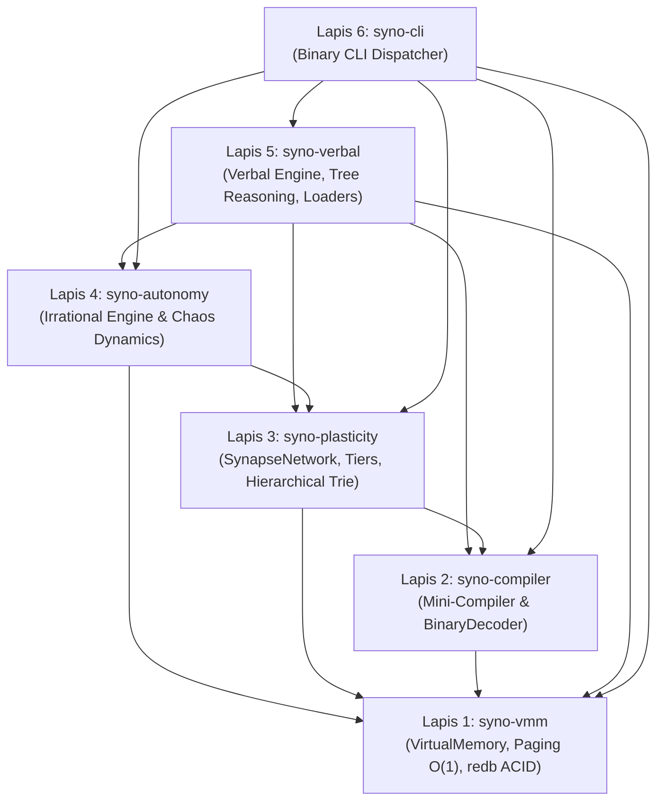

# 🧠 synapsis

[](https://github.com/ratuaurion-dev/synapsis/actions/workflows/ci.yml)
[](https://github.com/ratuaurion-dev/synapsis/actions/workflows/security.yml)
[](LICENSE)
[](https://www.rust-lang.org/)
[](https://github.com/cberner/redb)

> **Enterprise Neuroplastic Virtual Machine & Cognitive Binary VMM berbasis Cargo Workspace Multi-Crate.**

`synapsis` adalah arsitektur mesin virtual kognitif eksperimental yang menggabungkan prinsip rekayasa sistem tingkat rendah (*Virtual Memory Manager Paging O(1)*) dengan mekanisme neuroplastisitas biologis (*Hebbian Plasticity*), kompresi bitcode mandiri, dan modul otonomi denyut irasional non-linier (*Arnold Circle Map & Chaos Dynamics*).

---

## 🏛️ Arsitektur Cargo Workspace (Strict Layered DAG)

Proyek ini menerapkan arsitektur Cargo Workspace multi-crate yang bersih, terenkapsulasi ketat, dan bebas dari ketergantungan melingkar (*circular dependencies*):

```text
synapsis/
├── Cargo.toml                      # Root Cargo Workspace Resolver v2 & dependencies
├── README.md                       # Dokumentasi arsitektur dan panduan penggunaan
├── LICENSE                         # MIT License
├── SECURITY.md                     # Kebijakan pelaporan kerentanan keamanan
├── .gitignore                      # Proteksi file biner, database, dan secrets
├── .github/
│   ├── dependabot.yml              # Otomasi audit dependensi berkala
│   └── workflows/
│       ├── ci.yml                  # CI Pipeline (fmt, clippy, test, release build)
│       └── security.yml            # Security vulnerability audit (cargo-audit)
├── data/
│   ├── .gitkeep
│   └── conversations.json          # Seed template dataset percakapan
└── crates/
    ├── syno-vmm/                   # Lapis 1: Fondasi VMM & redb ACID Storage
    ├── syno-compiler/              # Lapis 2: Kompailer Mini Bitcode & Binary Decoder
    ├── syno-plasticity/            # Lapis 3: Jaringan Sinapsis & Hierarchical Trie
    ├── syno-autonomy/              # Lapis 4: Kesadaran & Dinamika Fase Irasional
    ├── syno-verbal/                # Lapis 5: Kognisi Verbal, Penalaran, & Data Loaders
    └── syno-cli/                   # Lapis 6: Antarmuka CLI & Command Dispatcher
```

### Hirarki Ketergantungan Satu Arah:



---

## 📦 Rincian Modul Crate

| Crate | Tanggung Jawab Utama | Dependensi Internal |
|---|---|---|
| [`syno-vmm`](crates/syno-vmm) | Virtual Memory paging 64-byte O(1), alokasi kontigu, dan persistensi ACID `redb`. | *None* (Layer 1) |
| [`syno-compiler`](crates/syno-compiler) | Kompilasi teks/kalimat ke opcode biner padat dan `BinaryDecoder` raw bytes. | `syno-vmm` |
| [`syno-plasticity`](crates/syno-plasticity) | `SynapseNetwork`, `MemoryTier` (`Core` vs `Dynamic`), LTP Hebbian, dan Hierarchical Trie. | `syno-vmm`, `syno-compiler` |
| [`syno-autonomy`](crates/syno-autonomy) | `IrrationalAutonomyEngine` (Golden Ratio Arnold Map), denyut fase $\theta_n$, dan `ChaosEngine`. | `syno-vmm`, `syno-plasticity` |
| [`syno-verbal`](crates/syno-verbal) | `VerbalEngine`, `ReasoningEngine`, inferensi Read-Only, dan streaming dataset loader O(1) RAM. | `syno-vmm`, `syno-compiler`, `syno-plasticity`, `syno-autonomy` |
| [`syno-cli`](crates/syno-cli) | Binary executable (`main.rs`) untuk evaluasi argumen CLI tanpa logika bisnis di antarmuka. | Semua crate `syno-*` |

---

## 🚀 Panduan Penggunaan & Eksekusi

### 1. Menjalankan Mode Obrolan Interaktif Otonom (`--chat`)
Inferensi percakapan berjalan secara **Read-Only** untuk menjaga keaslian memori dari peluruhan prompt:
```bash
cargo run -p syno-cli -- --chat
```
Contoh keluaran sesi:
```text
============================================================
  💬 SYNO VERBAL COGNITION ENGINE - CHAT MODE (CLI)
============================================================

[USER >>] halo
  [Denyut Irasional] Siklus #1 | Fase θ: 0.6180 | Ketegangan E: 0.00 | Status Otonom: Homeostasis (Observe)
  [1] Navigasi Pohon Percabangan (Hierarchical Trie Traversal):
      - Simpul Pemicu / Seed     : "halo" (0x1000)
      - Total Cabang Traversal   : 8 langkah (Core: 8, Dynamic: 0)
      - Rata-Rata Konfidensi     : 95.0%

[SYNO BOT] >> "Halo juga! Senang bisa menyapa dan berinteraksi dengan Anda."
```

### 2. Melatih Dataset Eksternal ke Hierarchical Trie (`--train`)
Menelan korpus percakapan terstruktur (JSON) atau teks bebas secara streaming $O(1)$ RAM ke `redb`:
```bash
cargo run -p syno-cli -- --train data/conversations.json
```

### 3. Menjalankan Rangkaian Pengujian Lengkap
```bash
cargo test --workspace
```

### 4. Menjalankan Analisis Statis & Linting
```bash
cargo fmt --all --check
cargo clippy --workspace --all-targets -- -D warnings
```

---

## 🔒 Standar Keamanan & Perlindungan Data

- **Zero Unsafe Code**: 100% kode ditulis dalam safe Rust, menjamin ketiadaan data race, use-after-free, dan null-pointer dereferences.
- **Proteksi Database Persisten**: Database lokal `data/*.db` diabaikan oleh `.gitignore` sehingga data runtime tidak membocorkan state lokal atau mengotori repositori git.
- **Automated CI/CD Quality**: GitHub Actions Workflow memvalidasi format, linter clippy tanpa toleransi warning, dan kelulusan seluruh unit test pada setiap *pull request* dan *push*.
- **Security Audit & Dependabot**: Pemantauan otomatis mingguan terhadap celah keamanan dependensi melalui `cargo-audit` dan Dependabot.

---

## 📄 Lisensi

Didistribusikan di bawah lisensi **MIT License**. Lihat berkas [LICENSE](LICENSE) untuk informasi lebih lanjut.
